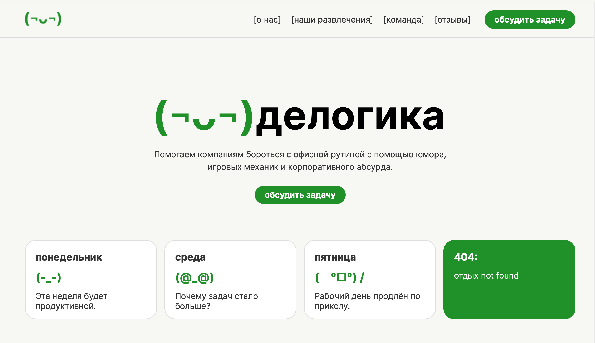

# Делогика

«Делогика» — учебный одностраничный сайт о корпоративных развлечениях, юморе и способах сделать офисные будни интереснее. На сайте есть описание проекта, карточки услуг, команда и отзывы. Страница создана на HTML и CSS, без адаптивной вёрстки.

## Ссылка на сайт

(https://milashatmn-cloud.github.io/delogica/index.html)

## Скриншот

## Автор

Воронина Милана Валерьевна, группа: **Б26УКИ02**.

## Что я научилась делать

- Создавать структуру одностраничного сайта на HTML: шапку, разделы, карточки и подвал.
- Работать с CSS-свойствами позиционирования, размерами и отступами.
- Применять псевдоклассы для оформления элементов.
- Разбираться в 3D-перевороте карточек с помощью `transform`, `perspective`, `transition` и `backface-visibility`.

## Использование ИИ

### Инструменты

1. ChatGPT — уровень помощи 3

Использовала для написания сложных CSS-фрагментов: 3D-переворота карточек команды, расположения карточек с помощью Flexbox, выравнивания кнопок в карточках услуг, оформления отзывов и закрепления верхнего меню при прокрутке страницы.

2. ChatGPT — уровень помощи 1–2

Использовала для объяснения свойств CSS и псевдоклассов, разбора структуры HTML и CSS, проверки кода и поиска возможных ошибок. ИИ помог разобраться в назначении отдельных свойств и понять, как работают элементы сайта.

### Записи о запросах

#### Запись №1 · [16.10.26] — переворот карточек команды (уровень 3)

- **Что я хотела сделать:** чтобы круглые карточки сотрудников при наведении переворачивались со смайлика на фотографию.
- **Что я спросила:** как сделать так, чтобы круглые карточки переворачивались, на обороте были другие материалы.
- **Что ответил ИИ:** написал CSS для `.team-flip`, `.team-flip-inner`, `.team-face`, `.team-front`, `.team-back` и `.team-back img`, в том числе с `perspective`, `transform-style: preserve-3d`, `rotateY(180deg)`, `transition`, `backface-visibility`, `inset: 0` и `object-fit: cover`. Позже объяснил принцип работы.
- **Что я изменила сама:** содержимое карточек.
- **Как я проверила:** сохранила изменения в VS Code, открыла сайт в браузере и навела курсор на карточки сотрудников. Проверила, что карточки плавно переворачиваются, вместо смайликов появляются фотографии, а при убирании курсора возвращается лицевая сторона.

#### Запись №2 · [16.10.26] — карточки услуг (уровень 3)

- **Что я хотела сделать:** расположить содержимое карточек услуг столбцом и выровнять кнопки с ценами по нижнему краю.
- **Что я спросила:** помоги выравнить карточки в CSS.
- **Что ответил ИИ:** написал фрагменты с `display: flex`, `flex-direction: column` для `.fun-card` и `margin-top: auto` для `.fun-button`.
- **Что я изменила сама:** содержимое, цвет.
- **Как я проверила:** сохранила изменения в VS Code, открыла сайт в браузере и проверила, что текст в карточках расположен правильно.

#### Запись №3 · [17.10.26] — расположение карточек в ряд (уровень 3)

- **Что я хотела сделать:** расположить несколько карточек рядом и распределить между ними ширину.
- **Что я спросила:** помоги с версткой карточек по ширине экрана.
- **Что ответил ИИ:** написал стили для карточек с `flex: 1` и `min-width: 0`, чтобы элементы делили свободное пространство.
- **Что я изменила сама:** настроила расстояние между карточками с помощью gap, добавила внутренние отступы padding, скруглила углы через border-radius и подобрала цвета карточек в соответствии с макетом.
- **Как я проверила:** сохранила изменения в VS Code, открыла сайт в браузере и посмотрела, правильно ли расположены карточки, одинаковая ли у них ширина и соответствуют ли они макету.

#### Запись №4 · [18.10.26] — оформление отзывов (уровень 3)

- **Что я хотела сделать:** расположить отзывы не строго друг под другом, а с чередованием по сторонам.
- **Что я спросила:** помоги расположить отзывы в разных частях блока, чтобы они чередовались справа и слева.
- **Что ответил ИИ:** написал CSS с псевдоклассом :nth-child() для выбора отдельных отзывов и свойством align-self для их выравнивания по разным сторонам.
- **Что я изменила сама:** изменила текст отзывов и подобрала расстояния между ними по макету.
- **Как я проверила:** [вписать, как реально проверяла расположение отзывов].

#### Запись №5 · [18.10.26] — фиксированное меню (уровень 3)

- **Что я хотела сделать:** закрепить верхнее меню при прокрутке и показать его поверх остальных блоков.
- **Что я спросила:** как сделать, чтобы меню оставалось сверху при прокрутке сайта?
- **Что ответил ИИ:** написал CSS с position: fixed для закрепления меню и z-index: 1000, чтобы оно находилось поверх других элементов.
- **Что я изменила сама:** настроила цвет, отступы и оформление меню.
- **Как я проверила:** сохранила код в VS Code, открыла сайт в браузере и прокрутила страницу. Меню осталось наверху.

#### Запись №6 · [28.10.26] — объяснение кода и псевдоклассов (уровень 1–2)

- **Что я хотела сделать:** понять свойства, которые используются в моём HTML и CSS, и проверить структуру сайта.
- **Что я спросила:** «Проверь мой код, объясни структуру и за что отвечает каждая функция»; «Что такое псевдокласс и где мы их задаём?»; затем попросила объяснить проще.
- **Что ответил ИИ:** объяснил box-sizing: border-box, position: relative, z-index, inset, backface-visibility, :hover, :active и :nth-child(), а также указал на ошибки в коде.
- **Что я изменила сама:** разобралась в назначении CSS-свойств и псевдоклассов.
- **Как я проверила:** сравнила объяснения ИИ со своим кодом в VS Code и посмотрела, как эти свойства работают на сайте в браузере.

### Фрагменты кода, написанные ИИ

1. box-sizing: border-box

Где в коде: в начале файла style.css, в универсальном селекторе \*, который применяется ко всем элементам страницы.

Для чего используется: включает отступы и границы в общие размеры элемента.

Запись: №6 (объяснение свойства).

2. position: fixed и z-index: 1000

Где в коде: .menu

Для чего используется: закрепляет меню в верхней части экрана и располагает его поверх других элементов.

Запись: №5.

3. flex: 1 и min-width: 0

Где в коде: .day-card, .fun-card, .team-card

Для чего используется: помогает равномерно распределить карточки по ширине контейнера.

Запись: №3.

4. display: flex и flex-direction: column

Где в коде: .fun-card

Для чего используется: располагает содержимое карточек услуг вертикально.

Запись: №2.

5. margin-top: auto

Где в коде: .fun-button

Для чего используется: прижимает кнопки с ценами к нижнему краю карточек.

Запись: №2.

6. perspective и transform-style: preserve-3d

Где в коде: .team-flip, .team-flip-inner

Для чего используется: создаёт эффект объёмного переворота карточек.

Запись: №1.

7. rotateY(180deg) и transition

Где в коде: .team-flip-inner, .team-back

Для чего используется: поворачивает карточки и делает анимацию плавной.

Запись: №1.

8. backface-visibility: hidden и inset: 0

Где в коде: .team-face

Для чего используется: скрывает обратную сторону элемента и располагает обе стороны карточки друг на друге.

Запись: №1.

9. object-fit: cover

Где в коде: .team-back img

Для чего используется: позволяет фотографиям полностью заполнять круглые карточки без искажения пропорций.

Запись: №1.

10. :nth-child() и align-self

Где в коде: .review-message:nth-child(1), .review-message:nth-child(2), .review-message:nth-child(3)

Для чего используется: располагает отзывы поочерёдно справа и слева.

Запись: №4.

### Выводы

ИИ объяснял CSS, помог написать несколько сложных фрагментов, которые я использовала в проекте: переворот карточек команды, выравнивание элементов и оформление отзывов. Особенно полезными были объяснения псевдоклассов на примерах из моего сайта. При проверке ИИ предложил адаптивную вёрстку, но я уточнила, что мы пока не умеем добавлять её в проект. Теперь я лучше понимаю, как HTML-контейнеры связаны со стилями CSS и как работает наведение на элементы.
